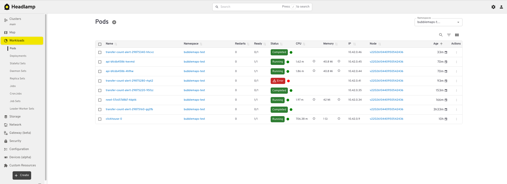

# Shib-ingestion-api

SHIB transfer pipeline: Confluent Kafka → ClickHouse → FastAPI, deployed on a single k3s VM.

## Architecture

```
Confluent Cloud (topic transfer_shib, 6 partitions, 7-day retention)
        │  SASL_SSL, outbound only
        ▼
ClickHouse 25.3 (StatefulSet, 10 GiB PVC) — 10 tables in schema.sql, main ones shown
  kafka_transfers (Kafka engine)
    └─► mv ─► transfers            (ReplacingMergeTree, key block_timestamp+unique_id)
                ├─► transfers_hourly      (AggregatingMergeTree, key hour)
                ├─► transfers_by_wallet   (ReplacingMergeTree, key wallet+time; 2 views, sent/received)
                ├─► wallet_stats          (AggregatingMergeTree, key wallet)
                ├─► wallet_links          (AggregatingMergeTree, key wallet+counterparty)
                ├─► transfers_by_amount   (ReplacingMergeTree, key amount+time)
                └─► funder_wallets        (MergeTree, refreshable view every 10 min from wallet_stats)
                      └─► funder_stats    (MergeTree, refreshable view, depends on funder_wallets)
        ▲ read-only user, 10 s / 10k rows / 1 GB per query
FastAPI (2 pods) ── /transfers, /stats/timeseries, /wallets/{a}/{transfers,stats,links,links/{b},siblings,similar}
        ▲
Traefik ◄── Newt tunnel ◄── Pangolin (TLS, domain) ◄── internet
CronJob transfer-count-alert (hourly, ClickHouse vs SQD portal)
```

Everything runs on one Debian VM with k3s (`make vm-deploy VM=<ip>`). The host firewall allows only
ssh inbound; the API and the Headlamp UI are published through a Pangolin tunnel.

## Infrastructure

> **Note:** the netcup server was shut down on 2026-10-25, after the review. The URLs below
> (shib-api.marco33.fr, k8s.marco33.fr) are no longer reachable. Everything can be redeployed
> on any Debian/Ubuntu VM with `make vm-deploy VM=<ip>`.

The whole stack runs on one netcup VPS (2 vCore, 4 GB, Debian 13) with a single-node k3s cluster,
deployed with `make vm-deploy VM=<ip>` from the working tree. The host firewall allows only ssh
inbound; the API and the Headlamp UI are published through a Pangolin tunnel (the `newt` pod), so
no service port is open on the VM.

Pods in the `bubblemaps-test` namespace, seen from Headlamp:



`clickhouse-0` (1 GiB in use of a 2.5 GiB limit), two `api` pods, `newt` for the tunnel, and the
hourly `transfer-count-alert` jobs. The one in Error is the reorg alert described below; the runs
before and after it completed.

## API

Public at https://shib-api.marco33.fr, interactive docs at https://shib-api.marco33.fr/docs.

```sh
# latest transfers
curl -s "https://shib-api.marco33.fr/transfers/latest?limit=5"

# transfers per hour over the last day, per day over the last week
curl -s "https://shib-api.marco33.fr/stats/timeseries?range=24h"
curl -s "https://shib-api.marco33.fr/stats/timeseries?range=7d"

# who moved this exact amount in the last 7 days
curl -s "https://shib-api.marco33.fr/transfers/by-amount?amount=1466985.391292666&range=7d"

# one wallet: stats, transfers, direct counterparties
curl -s "https://shib-api.marco33.fr/wallets/0xc80afd311c9626528de66d86814770361fe92416/stats"
curl -s "https://shib-api.marco33.fr/wallets/0xc80afd311c9626528de66d86814770361fe92416/transfers?limit=10"
curl -s "https://shib-api.marco33.fr/wallets/0xc80afd311c9626528de66d86814770361fe92416/links?limit=10"

# link between two wallets: hops=1 direct, hops=2 through shared counterparties, null if none
curl -s "https://shib-api.marco33.fr/wallets/0xc80afd311c9626528de66d86814770361fe92416/links/0x0d0707963952f2fba59dd06f2b425ace40b492fe"

# wallets funded by the same first sender, and wallets with a similar address book
curl -s "https://shib-api.marco33.fr/wallets/0xc80afd311c9626528de66d86814770361fe92416/siblings"
curl -s "https://shib-api.marco33.fr/wallets/0xc80afd311c9626528de66d86814770361fe92416/similar?min_shared=2"
```

## Limits at larger scale

Scale comes with more data and more load. The first step is to monitor every service, find the
bottleneck, add a scaling solution for it, and put guards in place against malicious or expensive
users. In practice the bottleneck is most often the database, not the application.

- **Single node.** No replication, no sharding: ClickHouse, its disk and the Kafka consumer are one
  point of failure. ClickHouse scales by adding nodes: replicas for availability and read load,
  shards when a single node can no longer hold or scan the data, and more Kafka consumers across
  those nodes for higher ingestion throughput.
- **Memory.** 2.5 GiB for ClickHouse caps concurrent analytical queries; the similar-wallets
  query expands up to 200 neighbours and grows with their degree. On a real node, give ClickHouse
  memory and move the hub threshold into a precomputed flag.
- **API protection.** ClickHouse's per-query limits (10 s, 10k rows, 1 GB) protect the database,
  not the pods. Add rate limiting on the API, and Cloudflare in front of it for bot and DDoS
  protection.

## Transfer-count alert job

**Goal.** Prove every hour that ClickHouse holds exactly the SHIB transfers that exist on chain,
by comparing against an independent source: the SQD portal API.

`job/check.py` runs as a CronJob at 20 past every hour. Run it by hand with `make alert-check`;
list past runs and any ALERT lines with `make alerts`.

### Alert of 2026-10-20, hour 16:00–17:00 UTC: one extra row, caused by a reorg

**Trigger.** The 17:20 run reported `sqd=171 clickhouse=172 diff=1`.

**Investigation.** One transaction,
[0xc938d0…](https://etherscan.io/tx/0xc938d00a5155f8ff772b30e112bbe4c8cab5a3dc5a16b3523913e08d25ab4f3a),
appears twice in Kafka with two different `unique_id`s and `block_timestamp`s (16:46:11 and
16:47:35). On chain it exists once, in block [26235088](https://etherscan.io/block/26235088)
at 16:47:35. The block at 16:46:11 was dropped by a reorg
([slot 15474229](https://beaconcha.in/slot/15474229)).
